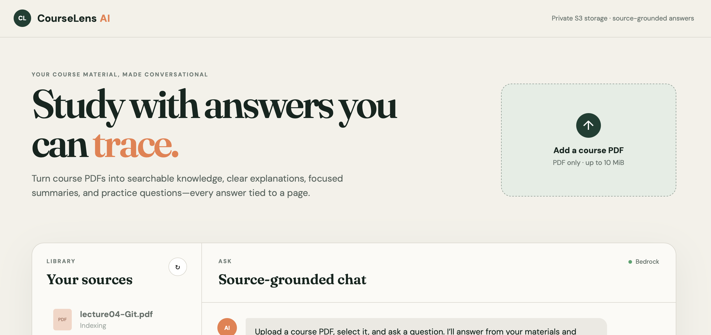
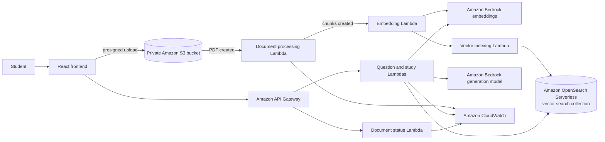

# CourseLens AI — Cloud-Based AI Study Assistant

CourseLens AI turns course PDFs into searchable, source-grounded study material.
Students upload a PDF, select one or more indexed sources, ask questions, and
generate summaries, key concepts, practice questions, or study guides with
filename and page citations.

The project is a production-minded AWS portfolio system: event-driven ingestion,
Bedrock embeddings and generation, OpenSearch Serverless vector retrieval,
least-privilege IAM, repeatable CloudFormation, observable failures, and an
automated test suite spanning backend, frontend, and infrastructure contracts.


> See the [portfolio case study](docs/portfolio.md),
> [deployment evidence](docs/deployments/phase-17-dev.md), and
> [interview guide](docs/interview-guide.md).



## Capabilities

- Secure, direct-to-S3 PDF uploads using presigned URLs
- Event-driven PDF extraction with AWS Lambda
- Configurable, page-aware text chunking
- Text embeddings with Amazon Bedrock
- Grounded response generation with Amazon Bedrock
- Semantic vector search with Amazon OpenSearch Serverless
- Grounded answers with citations and explicit no-answer behavior
- Summaries, study guides, and source-grounded practice questions
- A responsive React interface for uploads, document selection, chat, and study tools
- Reproducible infrastructure, least-privilege IAM, structured logs, and tests

## Engineering highlights

- Direct browser-to-S3 uploads avoid proxying multi-megabyte PDFs through Lambda.
- EventBridge separates extraction, embedding, and indexing into retryable stages.
- Deterministic chunk IDs make at-least-once indexing idempotent.
- Query and study paths use different retrieval thresholds because narrow
  questions and broad study-generation tasks have different relevance behavior.
- Prompt construction treats PDF text as untrusted data; output without valid
  `[Source N]` markers is rejected.
- The OpenSearch collection can scale to zero while idle, and model/context limits
  bound per-request cost.

## Repository layout

```text
ai-study-assistant/
├── frontend/                 # React/Vite client and browser-level tests
│   └── src/
├── backend/
│   ├── functions/            # One package per Lambda responsibility
│   │   ├── ask_question/
│   │   ├── create_upload_url/
│   │   ├── generate_embeddings/
│   │   ├── index_document/
│   │   ├── generate_questions/
│   │   ├── manage_documents/
│   │   └── process_document/
│   ├── shared/               # Validation, AWS clients, models, and RAG helpers
│   └── tests/                # Backend unit tests
├── infrastructure/           # Reproducible AWS infrastructure
│   ├── artifacts.yaml        # Private Lambda deployment-package storage
│   └── foundation.yaml       # S3, IAM, events, and application Lambdas
├── docs/                     # Architecture and engineering decisions
├── .env.example              # Configuration names without credentials
├── .editorconfig
└── .gitignore
```

Each Lambda receives its own thin handler package. Code used by multiple
functions belongs in `backend/shared`, which keeps handlers focused while
making validation, chunking, retrieval, and prompt construction testable.

## Architecture



Private storage, presigned PDF upload, event-driven extraction, page-aware
chunking, Bedrock embeddings, OpenSearch vector indexing and retrieval,
grounded generation, API Gateway, citations, study tools, and the React client
are implemented.

## Run locally

```bash
git clone https://github.com/TarunV750/ai-study-assistant.git
cd ai-study-assistant/frontend
npm install
cp .env.example .env.local
# Set VITE_API_BASE_URL to the deployed API Gateway endpoint.
npm run dev
```

Open `http://localhost:5173`, upload a text-based PDF under 10 MiB, wait for
**Ready**, and select it before using chat or study tools.

## Prerequisites

- Git
- Python 3.12+
- Node.js 20+
- An AWS account and AWS CLI v2
- Permission to enable and invoke selected Amazon Bedrock models

Model IDs, regions, limits, and resource identifiers will remain configurable.
We will verify current AWS availability before choosing them.

## Verification

From the repository root:

```bash
make test
make infra-lint
make infra-validate AWS_REGION=us-east-1
API_ENDPOINT=https://... DOCUMENT_ID=... make e2e-smoke
```

The local suite currently includes 82 backend/infrastructure tests and 4 React
tests. The Phase 17 live smoke test verifies document listing, safe headers,
exact CORS, presigned upload instructions, cited Q&A, and cited Study Guide
generation against AWS.

Phase design details are documented in the numbered files under [`docs/`](docs/).
Deployment and verification commands are documented in
[`infrastructure/README.md`](infrastructure/README.md). AWS deployment has to be
performed with authenticated CLI credentials for the intended development
account.

The non-sensitive Phase 2 record remains in
[`docs/deployments/phase-2-dev.md`](docs/deployments/phase-2-dev.md).

## Documentation

- [Portfolio case study](docs/portfolio.md)
- [Architecture](docs/architecture.md)
- [Security, cost, and complexity review](docs/phase-19-engineering-review.md)
- [Interview-ready explanation](docs/interview-guide.md)
- [Incremental roadmap](docs/roadmap.md)

## Security baseline

- Never place AWS credentials in frontend code or committed files.
- Keep the document bucket private and use short-lived presigned upload URLs.
- Scope IAM permissions to the required actions and resources.
- Validate API input and uploaded file type/size on trusted backend paths.
- Treat uploaded document text as untrusted data when constructing prompts.

The development API is a single-user portfolio sandbox. Exact CORS and
throttling reduce accidental exposure, but CORS is not authentication. Add a
Cognito/JWT authorizer and per-user storage/vector isolation before public,
multi-user production use.

## License

No license has been selected yet. Add one before distributing the project.
