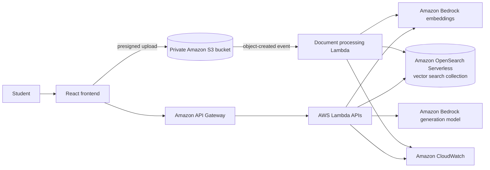

# Cloud-Based AI Study Assistant

A portfolio project for uploading course PDFs and asking grounded questions about
their contents using retrieval-augmented generation (RAG) on AWS.

> **Current status:** Phase 3 secure PDF upload infrastructure is implemented.
> The `dev` deployment status and live verification evidence are recorded in
> [`docs/deployments/phase-3-dev.md`](docs/deployments/phase-3-dev.md).

## Planned capabilities

- Secure, direct-to-S3 PDF uploads using presigned URLs
- Event-driven PDF extraction and chunking with AWS Lambda
- Embeddings and response generation with Amazon Bedrock
- Semantic vector search with Amazon OpenSearch Serverless
- Grounded answers with citations and explicit no-answer behavior
- Summaries, study guides, and source-grounded practice questions
- A React interface for uploads, document selection, chat, and study tools
- Reproducible infrastructure, least-privilege IAM, structured logs, and tests

## Repository layout

```text
ai-study-assistant/
├── frontend/                 # React client (implemented in a later phase)
│   └── src/
├── backend/
│   ├── functions/            # One package per Lambda responsibility
│   │   ├── ask_question/
│   │   ├── create_upload_url/
│   │   ├── generate_questions/
│   │   ├── manage_documents/
│   │   └── process_document/
│   ├── shared/               # Validation, AWS clients, models, and RAG helpers
│   └── tests/                # Backend unit tests
├── infrastructure/           # Reproducible AWS infrastructure
│   ├── artifacts.yaml        # Private Lambda deployment-package storage
│   └── foundation.yaml       # IAM, logs, private documents, upload Lambda
├── docs/                     # Architecture and engineering decisions
├── .env.example              # Configuration names without credentials
├── .editorconfig
└── .gitignore
```

Each Lambda receives its own thin handler package. Code used by multiple
functions belongs in `backend/shared`, which keeps handlers focused while
making validation, chunking, retrieval, and prompt construction testable.

## Target architecture



Only the storage and presigned-upload portion is implemented so far. API
Gateway, PDF processing, Bedrock, OpenSearch, and the React client remain later
phases.

## Prerequisites for later phases

- Git
- Python 3.12+
- Node.js 20+
- An AWS account and AWS CLI v2
- Permission to enable and invoke selected Amazon Bedrock models

Model IDs, regions, limits, and resource identifiers will remain configurable.
We will verify current AWS availability before choosing them.

## Current verification

From the repository root:

```bash
make backend-test
make infra-lint
make infra-validate AWS_REGION=us-east-1
```

These commands run the upload-handler unit tests, lint both CloudFormation
templates, and ask AWS to validate them. Install the infrastructure development
requirements before linting. Use Python 3.12 or newer for development work.

Phase 3 deployment and verification commands are documented in
[`infrastructure/README.md`](infrastructure/README.md). AWS deployment has to be
performed with authenticated CLI credentials for the intended development
account.

The non-sensitive Phase 2 record remains in
[`docs/deployments/phase-2-dev.md`](docs/deployments/phase-2-dev.md).

## Delivery roadmap

Development follows the staged plan in [`docs/roadmap.md`](docs/roadmap.md).
Each major phase will be implemented, tested, explained, and committed before
the next phase begins.

## Security baseline

- Never place AWS credentials in frontend code or committed files.
- Keep the document bucket private and use short-lived presigned upload URLs.
- Scope IAM permissions to the required actions and resources.
- Validate API input and uploaded file type/size on trusted backend paths.
- Treat uploaded document text as untrusted data when constructing prompts.

Detailed threat modeling and controls will be added with the relevant features.

## License

No license has been selected yet. Add one before distributing the project.
