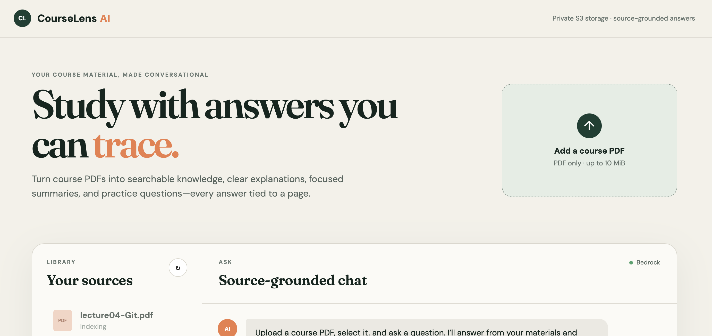
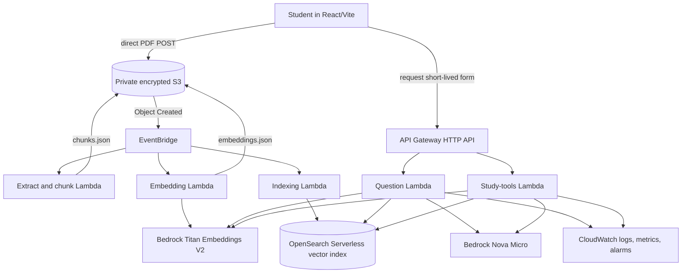

# CourseLens AI portfolio case study

## The problem

Students often have the answer somewhere in a lecture PDF but cannot quickly
locate it, connect related concepts, or verify whether an AI explanation actually
came from their course. A generic chatbot can answer fluently while silently
using outside knowledge. CourseLens AI instead makes the uploaded material the
explicit evidence boundary.

## The solution

CourseLens AI is an event-driven retrieval-augmented generation system on AWS.
The browser uploads a PDF directly to private S3 using a constrained presigned
form. Independent Lambda stages extract page-aware text, create overlapping
chunks, generate Titan embeddings, and index deterministic chunk records in
OpenSearch Serverless. HTTP APIs then retrieve relevant passages and use Amazon
Nova to create cited answers or study material.

## Architecture

## Decisions that matter

### Direct-to-S3 uploads

PDF bytes do not pass through API Gateway or Lambda. This reduces latency and
compute cost while a signed policy still constrains object key, content type,
metadata, encryption header, size, and expiry.

### Event-driven processing

Extraction, embedding, and indexing are separate functions connected through
S3 events and EventBridge. Each stage writes a completion artifact last, so the
next stage can validate a stable contract. Transient service failures are raised
for retry; permanent document failures become safe status records.

### Page-aware, deterministic retrieval

Chunks never cross page boundaries and retain page/character offsets. Chunk IDs
are deterministic, allowing retry-safe OpenSearch `index` operations and precise
filename/page citations.

### Two retrieval policies

A narrow question uses a relevance threshold to avoid answering from weak
matches. A broad Study Guide query operates only on explicitly selected
documents and retrieves their top passages without the Q&A cutoff. This
distinction fixed a real production bug where valid study material was rejected
as “not relevant.”

### Grounding is checked after generation

Prompts delimit PDF text as untrusted source data and forbid following embedded
instructions. The API also validates `[Source N]` markers and returns only cited
source metadata; uncited model output is rejected.

## Verification evidence

- 82 Python tests cover handlers, validation, chunking, embeddings, indexing,
  retrieval, RAG, study tools, and infrastructure contracts.
- 4 React tests cover PDF validation, selection, question submission, study-tool
  enablement, and citation rendering.
- CloudFormation passes local lint and AWS template validation.
- A reusable live smoke test checks seven API behaviors against the deployed
  development stack.
- CloudFormation drift detection is part of release verification.

## Debugging stories

1. **Indexing authorization:** adding filename provenance to an existing vector
   index required the narrowly scoped `aoss:UpdateIndex` permission. Safe bulk
   error extraction exposed the hidden authorization exception, the policy was
   corrected, and the same 23-chunk document indexed successfully.
2. **Study Guide false no-answer:** a broad study query used the Q&A relevance
   threshold. Separating retrieval policies and requiring explicit document
   selection produced a cited guide across multiple lecture pages.
3. **AWS drift normalization:** API Gateway normalized header case and a log ARN.
   Drift detection identified the difference so the template could describe the
   actual deployed state exactly.

## Production evolution

The current development stack is intentionally a single-user portfolio sandbox.
Before multi-user production use, add Cognito/JWT authentication, tenant IDs on
every S3 and vector record, per-tenant authorization filters, deletion and
retention workflows, WAF/rate quotas, alarm notification targets, and a hosted
frontend with an approved origin.
